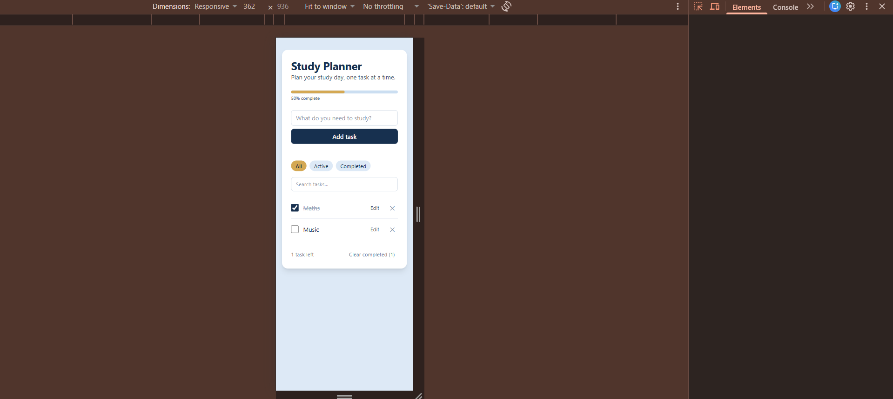
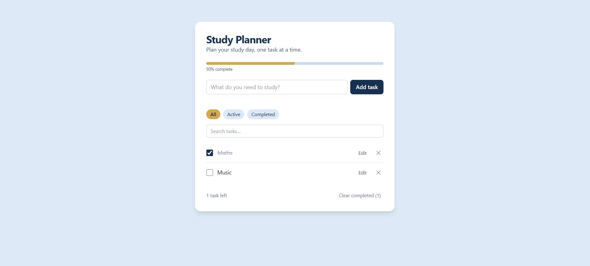

# Study Planner

A themed to-do list for students to plan their study day: add tasks, tick them off, edit them in place, and see progress at a glance. Built with HTML, Tailwind CSS v4 (Vite) and vanilla JavaScript.

**Author:** Olga Igabe
**Live app:** https://igabe179.github.io/week4-todo-app/

## Features

### Required
1. **Add a task** with the form (Enter or the Add task button); spaces at the start and end are trimmed.
2. **Validation:** empty text and text over 100 characters show an error message on the page (no `alert()`).
3. **Complete / uncomplete** with a checkbox; completed tasks are struck through and grey.
4. **Delete** a task with a confirmation (`confirm()`).
5. **Edit in place:** double-click the text or press Edit; Enter saves, Escape cancels, and empty text is not allowed.
6. **Filters:** All / Active / Completed, with the selected filter highlighted in gold and `aria-pressed`.
7. **Counter:** "1 task left" / "3 tasks left" with correct singular and plural.
8. **Clear completed** removes every completed task (after a confirmation).
9. **Persistence:** tasks and the selected filter are saved in `localStorage` and survive a page refresh.
10. **Empty state:** a friendly message for each filter when there are no tasks to show.

### Extra features ⭐
- ⭐ **Search box** that filters tasks as you type (`input` event).
- ⭐ **Progress bar** showing the percentage of tasks completed (`role="progressbar"` with `aria-valuenow`).

## User stories
| # | User story | Done when |
|---|---|---|
| US1 | As a student, I want to add a study task so that I remember it. | Enter or the button adds it to the top; the input clears and keeps focus. |
| US2 | As a student, I want clear feedback when my input is invalid. | Empty or 100+ character text shows a message on the page that disappears when I type. |
| US3 | As a student, I want to mark tasks as done so that I can track progress. | The checkbox (or Space) toggles done; done tasks are struck through. |
| US4 | As a student, I want to delete a task I no longer need. | Delete asks for confirmation, then removes it. |
| US5 | As a student, I want to fix a typo in a task. | Double-click or Edit opens a text box; Enter saves, Escape cancels. |
| US6 | As a student, I want to filter tasks so that I can focus. | All / Active / Completed show the matching tasks; the active filter is highlighted. |
| US7 | As a student, I want to see how much is left and how far I've come. | The counter shows tasks left; the progress bar shows % complete. |
| US8 | As a student, I want to find a task quickly. | Typing in the search box shows only matching tasks. |
| US9 | As a student, I want my tasks to survive a refresh. | Tasks and the filter are still there after reloading. |

## State shape
All tasks live in one array, and `render()` draws the whole list from it:
```js
let tasks = [
  { id: 1760860800000, text: "Revise loops", done: false, createdAt: 1760860800000 },
];
let currentFilter = "all";   // "all" | "active" | "completed" (saved in localStorage)
let editingId = null;        // id of the task being edited, or null
let searchQuery = "";        // text typed in the search box
```
The counter, empty-state message, progress percentage and visible list are **derived** from this state on every render, so they never get out of sync.

## Screenshots
| Mobile (360px) | Desktop (1280px) |
|---|---|
|  |  |

## How to run locally
```bash
git clone https://github.com/IGABE179/week4-todo-app.git
cd week4-todo-app
npm install
npm run dev
```
Then open the address Vite prints (usually http://localhost:5173/).

## Challenges and what I learned

One of my main challenges was fixing a bug that caused a feature of my Study Planner to stop working as expected. I used the browser DevTools Console and Network tab to investigate the problem and look for errors. After checking the results, I identified the cause of the bug and made changes to fix it. This experience taught me to be patient when debugging. I also learned that fixing bugs is an important part of building a working and reliable website.